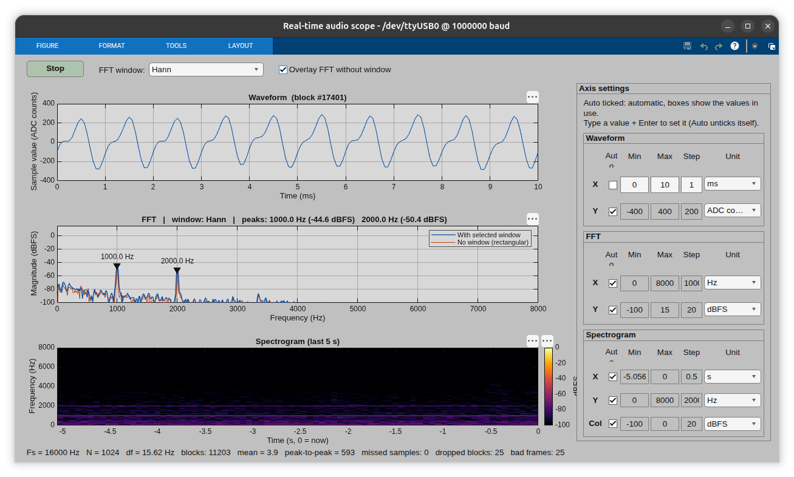

# lab_ii_signal

Source code and results for the **Signals & Systems / DSP Practical Labs — Assignment II** (Group 7).



## Repository layout

| Folder | Contents |
|---|---|
| [`task1/`](task1) | ESP32 + analog electret mic (MAX4466/MAX9814). Hardware-timer ADC sampling at 10 kS/s, ping-pong buffers, binary USB stream, MATLAB real-time waveform / FFT / spectrogram with Hann-vs-rectangular window comparison. |
| [`task2/`](task2) | ESP32 + INMP441 I²S MEMS mic at 16 kS/s (I²S + DMA), MATLAB viewer. |
| [`task3/`](task3) | DE10-Lite MAX 10 FPGA sampling at 16 kS/s (on-chip ADC or MCP3202 over SPI), Block-RAM sample buffer, FPGA→ESP32 SPI link, ESP32 USB bridge, MATLAB/Python host. See [`task3/README.md`](task3/README.md). |
| [`mini_project/`](mini_project) | **Mini Shazam** — Python GUI that identifies a song from 5–10 s of mic audio streamed from the FPGA/ESP32 using audio fingerprinting (Wang, ISMIR 2003). See [`mini_project/README.md`](mini_project/README.md). |
| [`docs/`](docs) | Circuit photos and screenshots. |

```
task1/  firmware/task1_adc_mic/       Arduino sketch (ESP32 ADC + hardware timer)
        host/realtime_audio_scope.m   MATLAB real-time scope
        results/                      oscilloscope captures, MATLAB plots, window vs. no window
task2/  firmware/task2_i2s_mic/       Arduino sketch (INMP441 over I2S)
        firmware/inmp441_stream/      alternative I2S streaming sketch
        host/inmp441_viewer.m         MATLAB viewer
        results/plots/
task3/  fpga/                         VHDL sources, testbench, Quartus TCL scripts
        esp32/task3_esp32_bridge/     ESP32 SPI-master → USB bridge
        host/                         task3_host.m / task3_host.py
        docs/                         wiring + checklist pages and example plots
mini_project/                         Mini Shazam (Python)
```

## Common stream format

The ESP32 firmware sends binary frames over USB serial (≥1 Mbaud):

```
[0xAA 0x55 0xAA 0x55] [uint32 seq] [uint32 drops] [N × int16 samples]   (little-endian)
```

Close the Arduino Serial Monitor before starting the MATLAB/Python host.

## Quick start

1. Flash the sketch for the task with the Arduino IDE (ESP32 board package).
2. Set the serial port in the host script, then run it in MATLAB (or `python task3/host/task3_host.py`).
3. Task 3 FPGA: `cd task3/fpga && ./build.sh` (or `build.bat`) to create and compile the Quartus project, then program the DE10-Lite.
4. Mini project: `cd mini_project && pip install -r requirements.txt && python app.py`.
